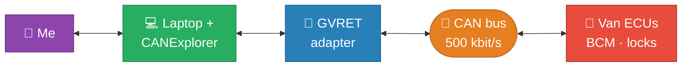

I didn't just want to *know* which CAN message unlocks my van. I wanted to walk up to it with my **phone** in my
pocket and have the doors unlock on their own — and lock again when I wander off.

That takes two things: **find the frame**, then **make something in the van send it when my phone is near**. The
frame turned out to be **`0x351`**. Here are both halves.

> This is my own vehicle, on my own bench, with a cable I plugged in myself. Poking at a car's internal CAN bus
> needs physical access to that bus — it is not a remote attack, and it has nothing to do with the relay attacks
> that actually get cars stolen. Do it to cars you own, know your local laws, and don't be the reason manufacturers
> make this harder for the rest of us.
{: .prompt-warning }

## Half 1 — the bench rig that found the frame

To reverse-engineer the bus I put a laptop on it: a **GVRET** adapter clipped onto the CAN bus, exposed over the
network, with **CANExplorer** on the laptop driving it.

The body bus is **classic CAN at 500 kbit/s**. I had a community **DBC** for this platform loaded, so a lot of the
chassis traffic (steering angle, brake/ESP, alternator load…) decoded to real signal names straight away — the
keyless stuff, of course, is *not* in a public DBC, and that's the part worth hunting for.

## The problem: everything is moving

Here's the thing nobody tells you the first time: on a running vehicle, *hundreds* of identifiers are chattering
away constantly. Steering angle, wheel speeds, engine data, light sensors, climate — it's a firehose. If you just
press the fob and stare at a scrolling trace, you will see nothing, because you're looking at the wrong 400 frames
per second.

You need a way to ask the bus a single question: **"what changed *because* of what I just did?"**
{: .prompt-tip }

## Reaction analysis: baseline, then action

CANExplorer has a reverse-engineering view built exactly for this. The workflow is:

1. **Record baseline** — sit still, doors shut, nobody touching anything. CANExplorer learns what "normal" looks
   like: every identifier, and the set of values each byte/field normally takes.
2. **Action** — while it keeps recording, I pressed **lock** on the fob.
3. **Result** — it diffs the two. Anything that appeared, or took a value it never took during the baseline, is
   flagged.

The header says it all: **13 identifiers reacted (23 fields) — baseline 1317, action 3127 frames.** Out of the
entire firehose, thirteen IDs did something they hadn't done while the van was idle. That's a shortlist I can
actually read.

Most of those are noise-adjacent — courtesy lights, a door-ajar bit, the BCM waking things up. But scrolling the
list, three identifiers show up as something stronger than "a byte changed": **they're brand-new**. They never
transmitted *at all* during the baseline, and only appeared on the fob press:

There they are, tagged **`new identifier`**: **`0x273`**, **`0x351`**, and **`0x5D7`**. A frame that *only exists*
when you press the fob is a very different animal from a frame that's always there and merely changes — it's an
event, not a state. Keyless entry is an event. These three were the whole ballgame.

## Narrowing three down to one

Three candidates, and the tiebreaker is blunt: **replay each one and see which actually drives the locks.** `0x351`
was the one that reproduced the central-locking action when I sent it back onto the bus (next section). The other
two — `0x273` and `0x5D7` — came along with the button press but didn't actuate the doors on their own; my read is
that they're the remote waking the network and general BCM housekeeping around the event. `0x351` is the command.

## Confirming it: replay it from the laptop

Finding a candidate is a hypothesis. The test is simple and extremely satisfying: **put the frame back on the bus
yourself and see if the van obeys.** CANExplorer's **Transmit** panel does exactly that — type an ID and a payload,
send it once, or tick *Every* to send it periodically.

ID **`351`**, data **`1C 40 00 00`** — the exact payload the reaction analysis had caught — and **Send**:

<video controls preload="metadata" style="max-width:100%;height:auto;border-radius:8px;" poster="/assets/img/canexplorer/van-keyless/transmit-0x351.jpg">
  <source src="/assets/img/canexplorer/van-keyless/keyless-replay.mp4" type="video/mp4">
  Your browser doesn't support embedded video — <a href="/assets/img/canexplorer/van-keyless/keyless-replay.mp4">download the clip</a>.
</video>

The van answered. One frame, no fob, and the central locking actuates — the same thing that happens when you press
the physical button, because to the body controller it *is* the same thing. So `0x351 = 1C 40 00 00` is the
keyless-entry command. **Now I can retire the laptop and make it happen by itself.**

## Half 2 — the phone as a key

The laptop was scaffolding. For the real thing I left a **tiny always-on computer in the van** — wired to the CAN
bus through a small interface — running a bit of custom code. It does one job: watch for **my phone coming into
range over Bluetooth**, and when it does, drop `0x351` onto the bus. No app to open, no button to press; the phone
in my pocket *is* the key.

```mermaid
%%{init: {'themeVariables':{'fontSize':'20px'},'flowchart':{'nodeSpacing':55,'rankSpacing':75,'padding':14}}}%%
flowchart LR
    PH["📱 My phone<br/>in my pocket"]:::phone
    SVC["🤖 In-van computer<br/>proximity service"]:::svc
    ADP["🔌 CAN interface"]:::adapter
    BUS(["🧵 CAN bus"]):::bus
    CAR["🚐 Van BCM<br/>and door locks"]:::car
    PH -. "comes into<br/>Bluetooth range" .-> SVC
    SVC == "sends 0x351" ==> ADP
    ADP --> BUS
    BUS --> CAR
    classDef phone fill:#8e44ad,stroke:#5b2c6f,color:#ffffff
    classDef svc fill:#16a085,stroke:#0e6655,color:#ffffff
    classDef adapter fill:#2980b9,stroke:#1f618d,color:#ffffff
    classDef bus fill:#e67e22,stroke:#ba6318,color:#ffffff
    classDef car fill:#e74c3c,stroke:#a93226,color:#ffffff
```

All the hard-won knowledge — *frame `0x351`, payload `1C 40 00 00`* — collapses into one line of that service's
code. CANExplorer found it and proved it; the van-side service just repeats it on cue. Walk up, the doors unlock;
walk away, they lock.

> A proximity trigger is exactly the design that makes factory keyless entry **relay-able** — a strong-enough
> "my phone is near" signal can be forwarded by someone else. That's a fun fact to reproduce on your own van and a
> terrible thing to depend on for security. Mine is a toy, gated behind a device I physically control, on a bus an
> attacker would already need to be sitting on.
{: .prompt-warning }

## What I didn't do (and what's next)

I stopped at "lock/unlock." The interesting follow-ups are all about the *payload*:

- Which byte (or bit) selects **lock vs unlock vs boot**? The obvious next step is to lock, unlock, and open the
  tailgate in turn and watch which nibble of `1C 40 00 00` moves — then the proximity service can unlock on
  approach and lock on departure with the *right* frame for each. CANExplorer's **bit raster** turns that into a
  visual exercise rather than a hex-diffing one.
- Is there a **rolling code or counter**? For internal *body* CAN on this platform the lock command replays
  verbatim (as the clip shows), which is common — the security is "you had to be on the bus in the first place,"
  not cryptography on every frame.

## Why this worked

None of this needed a logic analyser, a soldering iron, or days of staring at hex. Two moves did it: **asking the
bus the right question** — *baseline, then action, then diff* — so a single frame fell out of a 400-frame-per-second
river, and then **retiring the laptop** in favour of a few lines that resend that one frame when my phone shows up.
The reverse-engineering is the clever part; the phone-as-a-key is almost free once you know which frame to send.

Want to try it on your own vehicle? CANExplorer is free and cross-platform:
[github.com/AKJ7/CANExplorer](https://github.com/AKJ7/CANExplorer). Bring a CAN adapter and a car you own.
